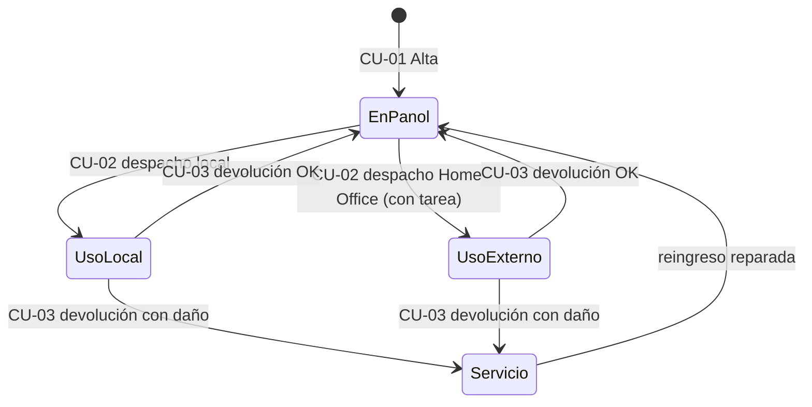
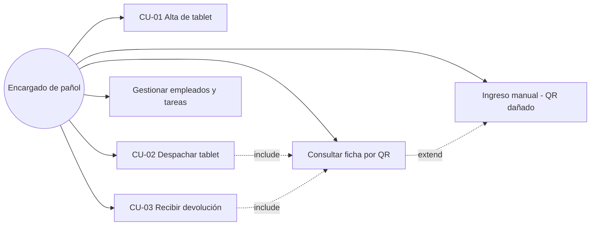
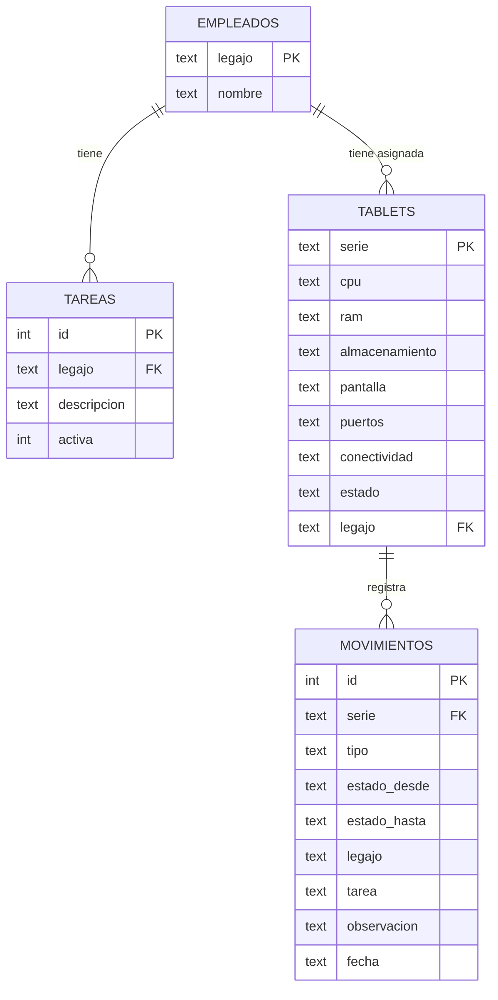

# Carpeta Técnica — Pañol-App
**TP N° 2 · Desarrollo de Sistemas · E.T. N° 35**

## 1. Alcance
App Android nativa (Kotlin) que gestiona el ciclo de vida de tablets corporativas mediante QR. Persistencia local en SQLite. Cámara y lectura de QR con ZXing (`zxing-android-embedded`).

## 2. Contenido del QR
JSON de una línea (también se acepta texto delimitado por `|`):

```json
{"sn":"TAB-0001","cpu":"Snapdragon 680","ram":"4 GB","sto":"64 GB","pan":"10.1\"","pue":"USB-C, Jack 3.5","con":"Wi-Fi, Bluetooth"}
```
Texto alternativo: `serie|cpu|ram|almacenamiento|pantalla|puertos|conectividad`.
Un contenido que no cumple ninguno de los dos formatos se trata como **QR inválido** y se ofrece el flujo manual.

## 3. Actores
- **Encargado de pañol** (usuario de la app): da de alta, despacha y recibe.
- **Empleado**: identificado por legajo; recibe la tablet.

## 4. Matriz de estados

| Estado | Significado | Transiciones permitidas |
|---|---|---|
| En Pañol | Disponible | → Uso Local, → Uso Externo (despacho) |
| En Uso Local (Oficina) | Dentro de la empresa, se devuelve al fin de jornada | → En Pañol, → Servicio Técnico (devolución) |
| En Uso Externo (Home Office) | Fuera de la empresa, requiere tarea | → En Pañol, → Servicio Técnico (devolución) |
| En Servicio Técnico | Fuera de circulación | → En Pañol (reingreso) |



Reglas de negocio:
- **RN1** Serie única (no se duplican altas).
- **RN2** Sólo se despacha una tablet *En Pañol*.
- **RN3** El legajo debe existir.
- **RN4** Home Office exige una tarea activa **del mismo empleado**; si no hay, alerta roja y se bloquea.
- **RN5** Sólo se devuelve una tablet en uso; si está dañada, se exige descripción y pasa a Servicio Técnico.
- **RN6** Todo cambio de estado genera un registro inmutable en `movimientos`.

## 5. Diagrama de casos de uso


## 6. Casos de uso expandidos

### CU-01 Registrar alta de tablet en pañol
| | |
|---|---|
| Actor | Encargado de pañol |
| Precondición | Ninguna; la tablet no existe en el sistema |
| Disparador | El encargado elige «Alta de tablet» |
| Postcondición | Tablet registrada *En Pañol*, QR generado, movimiento ALTA |

**Flujo principal**
1. El encargado escanea el QR (o completa el formulario manual).
2. El sistema decodifica y muestra la ficha técnica.
3. El encargado confirma el alta.
4. El sistema valida serie obligatoria y única (RN1), guarda con estado *En Pañol* y registra el movimiento.
5. El sistema genera el QR (JSON) con los atributos y lo muestra para imprimir y pegar en el reverso.

**Flujos alternativos**: A1 QR inválido → mensaje y ofrecer formulario manual. A2 Serie duplicada → alerta, se ofrece ver la ficha existente.

### CU-02 Despachar tablet
| | |
|---|---|
| Actor | Encargado de pañol (y empleado receptor) |
| Precondición | Tablet registrada y *En Pañol*; empleado con legajo cargado |
| Postcondición | Estado *Uso Local* o *Uso Externo*; legajo asociado; movimiento DESPACHO con tarea |

**Flujo principal**
1. El encargado escanea el QR; el sistema muestra la ficha y el botón «Despachar».
2. Ingresa el legajo; el sistema muestra el nombre del empleado y sus tareas activas.
3. Elige modalidad: *Uso local* o *Home Office*.
4. Selecciona la tarea asociada (opcional en local, obligatoria en Home Office).
5. Confirma; el sistema valida RN2–RN4, actualiza estado y registra el movimiento.

**Flujos alternativos**: A1 Home Office sin tarea → alerta visual roja y bloqueo (RN4). A2 Legajo inexistente → alerta. A3 Tablet no disponible → alerta con el estado actual.

### CU-03 Recibir devolución de dispositivo
| | |
|---|---|
| Actor | Encargado de pañol |
| Precondición | Tablet en *Uso Local* o *Uso Externo* |
| Postcondición | *En Pañol* (buen estado) o *En Servicio Técnico* (dañada); se libera el legajo |

**Flujo principal**
1. El encargado escanea el QR; el sistema muestra la ficha con el empleado asignado.
2. Elige «Recibir devolución» y verifica el estado físico.
3. Indica *buen estado* o *dañada* (con observación obligatoria).
4. El sistema actualiza el estado, libera el legajo y registra DEVOLUCION.

**Flujo alternativo**: A1 QR dañado → ingreso manual del serie (ver §8). A2 Tablet no prestada → alerta.

## 7. Diseño de la base de datos (SQLite)

`tablets.estado` ∈ {En Pañol, En Uso Local (Oficina), En Uso Externo (Home Office), En Servicio Técnico}. `tablets.legajo` es NULL salvo en uso. `movimientos` es el historial de trazabilidad.

## 8. Plan ágil
- **Sprint 1** — Interfaz, cámara/QR y ficha técnica (`MainActivity.scan`, `QrParser`, `ficha`).
- **Sprint 2** — Persistencia (`Db`), flujos de préstamo y devolución, vínculo con legajo, alertas de Home Office sin tarea.

## 9. Preparación de la defensa (cambios de último momento)
- **QR dañado**: ya implementado → *Ingreso manual*: búsqueda por serie, o alta manual completa.
- **Nuevo estado** (ej. «Extraviada»): agregar constante en `Estado`, transiciones en `Db` y color en la UI; sin cambio de esquema porque `estado` es texto.
- **Límite de días en Home Office**: agregar columna `fecha_salida` y validar al abrir la ficha.
- **Varias tablets por empleado**: ya soportado (no hay restricción 1:1); para limitarlo, validar en `despachar`.
- **Datos compartidos entre celulares**: hoy es SQLite local por dispositivo; evolución: API REST + base central.
